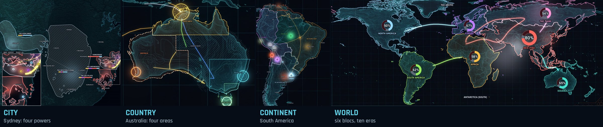
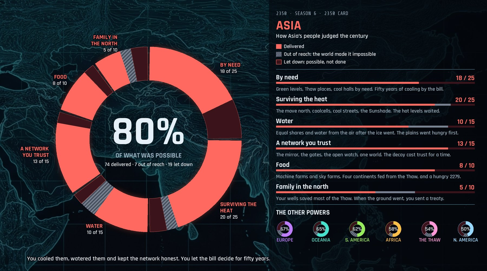

# 2350

**A strategy game about the next two centuries, designed in seven AI-run playtests.**

**For** anyone with a chat AI and an hour. **It does** run a strategy game about the next two centuries: you run one bloc from the 2140s to 2350, you build, trade, ally, spy, threaten and go to war, and at the end your own citizens score the future you gave them, out of what was possible. Highest score wins. There's no app. The engine is one rules file an AI game master reads, and the player never reads a rule.

**Try it in two minutes:** download [`play/game-master.txt`](play/game-master.txt) and [`play/world-board.jpg`](play/world-board.jpg), upload both to ChatGPT, Claude or Gemini in a new chat, and type **Let's play 2350**. The one-page card, [`play/how-to-play.png`](play/how-to-play.png), is all a player needs to read. A game is six eras of three questions each. The rules file holds a sample sealed envelope (the rivals' hidden temperaments and cards), so don't read it if you want to play. A Korean edition joins the repo once a native speaker has checked it.

**What's measured:** seven seasons at four scales, each one changing the rules (the table below; [the design journal](design/journal.md) has every rule and the playtest it came from). The memory test: a fresh game master given only a hundred-fact record of a season answered 20 of 20 questions, refused both trick questions, and caught four contradictions made in live play without anyone noticing. Season 7 was dropped in its fourth era and its lessons kept. A test bench now plays whole seasons unattended, one AI as game master and another as the player: in a five-persona sweep, a player who bundled several moves into every answer posted the best score, which led to one answer in your own words per era, with the rest left for later; after that change and a finale split in two, the game master's output fell from 70,000–143,000 tokens a season to about 52,000–56,000.

**Where the AI is:** the game master. It runs the rivals, the dice, the secrets and the score from the rules file, and seals each era's hidden state in one encoded line so it can't change the rivals' moves after seeing yours. The design, every playtest decision and every rule change are the designer's. The boards are drawn in code from real geography.



> Friends share one future, and in the year 2350 their citizens judge them for it.

This repo is a case study of how I designed it with AI: what I tried, what the playtests showed, and what changed because of them.

## How it was made

| Who | What they did |
|---|---|
| **Me** | The game design, every playtest decision, and the calls on what changed |
| **Claude** (Anthropic) | Game master for every season, the board engine code and the design docs |
| **Gemini** (Google) | The stylised base map the boards are drawn on |

**The loop:** play a whole season in chat with tap answers, write down what broke, change the rules, then play the next season at a different scale. Seven seasons over three days in October 2026.

| Season | Scale | I played | Eras | How it ended |
|---|---|---|---|---|
| 1 | Continental | Oceania, against Asia | 7 | *2350: The Continent Everything Ran Through* |
| 2 | Continental | Africa, against Europe and the Gulf | 8 | *2350: Pax Africana* |
| 3 | Country | Australia's Tropic North | 8 | *2350: The Kept Word* |
| 4 | Continental | South America's Andes | 8 | *2350: The Whole Truth* |
| 5 | City | Sydney's Port | 6 | *2350: One Port* |
| 6 | Global | Asia | 10 | *2350: The Open Gate* |
| 7 | Regional | South Korea, in East Asia | 3 of 8 | Dropped (see [What didn't work](#what-didnt-work)) |

Every season's boards, and how each one played out, are in **[the atlas](atlas/)**. The reasoning behind every rule is in **[the design journal](design/journal.md)**.

## What the playtests changed

Every rule below came from a problem that showed up in play or in feedback.

- **If everyone picks a disaster and they all happen, picking is pointless.** → **The hidden hand.** Each bloc secretly adds one shock card. One is drawn as the prologue, and the rest become live risks that may or may not fire.
- **A rival hit me and paid nothing for it.** → **No free hits.** Rivals pay for their moves exactly as a player does.
- **I destroyed a rival's base with a secret weapon I'd never built.** → **No conjured capabilities.** Anything big has to trace back to earlier investment, with a cost and a chance of being found out.
- **The human kept running away with the game.** → **The hidden verdict.** Your own people judge you, weighted by what they value and what they lived through. In season 4 the most powerful region I'd ever built finished third.
- **"I protected them for the entire season" (when the score felt too harsh).** → **Every hardship adds weight to what it threatened, and the score became "the 100":** each value splits into delivered, out of reach (the world's fault) and let down.
- **Does scoring by your own citizens push people away from helping others?** → **The world slice.** Fifteen points are judged by other countries' citizens. I re-scored two finished seasons to test it, and it bit hardest on the season where I'd invaded my neighbours.
- **Rivals should push back when it makes sense, but not so often it gets predictable.** → **Grievance with hidden breaking points.** A rival acts only with a motive, the means and a window, and you can see it coming in rumours and in what their people say.
- **A board gamer who read the pitch found it complicated, with no clear objective.** → **The player never reads the rules.** One card, a one-line goal, and the AI runs the rest.

There were smaller interface lessons too:

- **Three questions per card at most.** A four-question card dropped questions off my screen.
- **Anything to read gets its own turn,** so a question card never covers something I still have to read.

## The score: "the 100"



The weights grow out of each season: the culture you build and the hardships your people live through. So there's no single strategy to learn. Play your way, and your way becomes part of how you're judged.

## Testing the AI, not just the game

- **The memory test.** A fresh AI game master got only a structured record of season 6, about a hundred numbered facts. It answered 20 of 20 questions, said "not in the record" to both trick questions, and ran a consistent eleventh era. It also caught four contradictions I'd made in live play without noticing. That's the case for a consistency check whenever a fact is written.
- **The any-AI dry run.** A fresh agent ran the rules file through setup and a first era with no other help.
    - It applied the hidden-hand swap correctly.
    - It cut a Risk-style invasion down to what had actually been built, rolled for it in the open, and charged a cost.
    - It raised the target's grievance on schedule.
- **Sealing without files.** A chat AI can't hide notes between turns, so each era's hidden state goes on one encoded line at the end of its message. That line is its memory and its proof that it didn't change the rivals' moves after seeing your answer.
- **A Korean edition** from the same rules: a language layer plus a fixed name list, so the place names never drift.

## What didn't work

- **Season 7 didn't land, and I dropped it in its fourth era.** It used five real East Asian countries.
    - The live real-world tensions made the game master cautious, so the eras read like today's news with the dates changed.
    - Pure chance meant no shock fired in four rolls.
    - Building the friend pack mid-season broke the momentum, and it was the seventh season in three days.
    - **What came out of it:** shock odds that rise each era nothing fires, and keeping real flashpoints one step removed.
- **Painted era images.** I generated an image of my region each era. They never matched the boards: first too washed out, then too bleak. The boards stayed and the images went.
- **The runaway leader is still open.** The verdict makes leading not enough, but so far every brake on a leading human has been voluntary or has come at the end of the game.

## The boards


Every board is drawn in code (Python, Pillow, NumPy), so it costs nothing to redraw and always matches real geography.

- **Countries:** real country shapes from Natural Earth, warped onto the stylised base map with a fitted thin-plate spline.
- **Strength:** shows as glow, and borders carry over from era to era.
- **Each era's events:** stored as a small data file of numbered beats.
- **The city board:** built from real elevation data, so low ground floods for real.

## What's next

- **An outside playtest.** A friend is playing a season on ChatGPT with only the card and the rules file. *(Results to come.)*
- **Multiplayer:** friends sharing one world, the concept this all started from.
- **The Fleets add-on:** play a fleet with no land, in a world where ships are the only thing that crosses between the sealed networks.

## Repo map

```
play/      the rules file for any chat AI, the how-to-play card, the world board
atlas/     every finished season: what happened, an era board, the finale, the 2350 cards
design/    the design journal: every rule and the playtest it came from
engine/    the board renderer, with season 6 as sample data (see engine/README.md)
images/    the pictures in this README
```

## Credits

- **Map data:** [Natural Earth](https://www.naturalearthdata.com/) (public domain).
- **City elevation** (the Sydney boards), from Terrain Tiles:
    - Australia terrain data © Commonwealth of Australia (Geoscience Australia) 2017.
    - United States 3DEP (formerly NED) and global GMTED2010 and SRTM terrain data courtesy of the U.S. Geological Survey.
    - Global ETOPO1 terrain data U.S. National Oceanic and Atmospheric Administration.
- **Fonts:** Rajdhani and Share Tech Mono (in `engine/fonts/`, with their SIL Open Font License files), and IBM Plex Sans on the card.
- **Base map art:** made with Google Gemini.
- **Game master:** Claude, by Anthropic.

## Licence

Code (`engine/*.py`): MIT, in [`LICENSE`](LICENSE). The rules, the card, the design text, the season data and the images: [CC BY-NC 4.0](https://creativecommons.org/licenses/by-nc/4.0/), so they can be shared and adapted, but not sold. See [`LICENSE-CONTENT.md`](LICENSE-CONTENT.md).

© 2026 Mike O'Halloran
