# The atlas

Six seasons, played 23–24 October 2026, each in a single sitting with an AI game master running every rival. Each one runs from the Blackout in the 2140s to the year 2350 and takes its title from how it ended. Every board here was drawn in code from the season's record; the renderer and season 6's data are in [`../engine/`](../engine/).

The scale changed every season, which was the point: the same engine had to hold up for one city, one country, a continent and the whole world.

| Season | Scale | I played | Eras | Title |
|---|---|---|---|---|
| [1](#season-1-the-continent-everything-ran-through) | Continental | Oceania, against Asia | 7 | The Continent Everything Ran Through |
| [2](#season-2-pax-africana) | Continental | Africa, against Europe and the Gulf | 8 | Pax Africana |
| [3](#season-3-the-kept-word) | Country | Australia's Tropic North | 8 | The Kept Word |
| [4](#season-4-the-whole-truth) | Continental | South America's Andes | 8 | The Whole Truth |
| [5](#season-5-one-port) | City | Sydney's Port | 6 | One Port |
| [6](#season-6-the-open-gate) | Global | Asia | 10 | The Open Gate |

A seventh season, played as South Korea in East Asia, was dropped in its fourth era. Why it didn't land is in the [design journal](../design/journal.md).

---

## Season 1: The Continent Everything Ran Through

**Oceania against Asia · 7 eras.** Oceania never had the most of anything, and it became the region everything ran through:
- **Gates and routes:** an ore gate at Darwin, a network across the islands, and a closed Torres Strait with a reef gate.
- **Building:** a desalination coast, and a green Cape that took in the atoll peoples as their islands went under.
- **Sydney:** split into the Unfinished below and the Highlands above, a shape nobody planned.

This season set the core idea: building choices are the moves, and what each side depends on the other for is the engine.

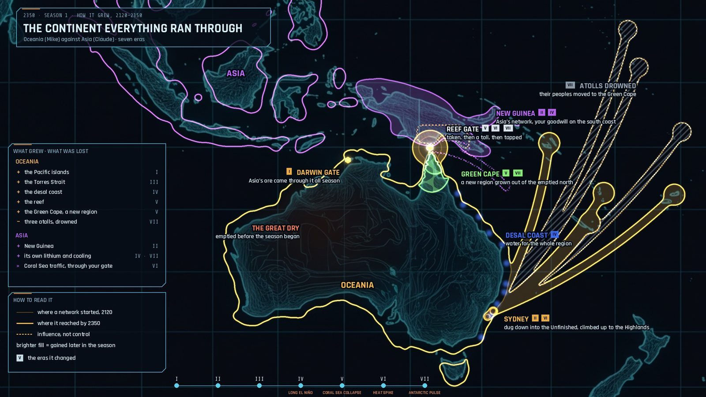
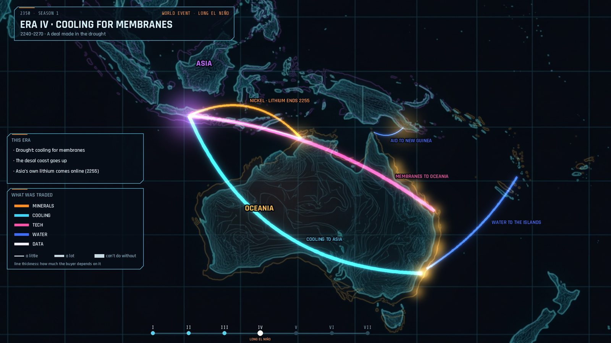

## Season 2: Pax Africana

**Africa against Europe and the Gulf · 8 eras.**
- **The build:** Africa built the Five Rivers federation and a solar coast.
- **The secret:** it tapped a relit undersea cable and read both rivals for 130 years. It defused a cornered Gulf with a toll instead of a blockade, and split a rival coalition with one whisper.
- **The bet:** an equatorial launch belt survived a solar flare the rivals didn't, and won the race for the Moon Link.
- **The ending:** exposed as the tap-holder, Africa bought off the anger with generosity and kept power by a landslide in the renewal vote.

It was a near-total win without a war, and also a quietly unsettling surveillance empire. **It showed that a kind, clever leader could run away with the game, and nothing in the rules stopped it.**

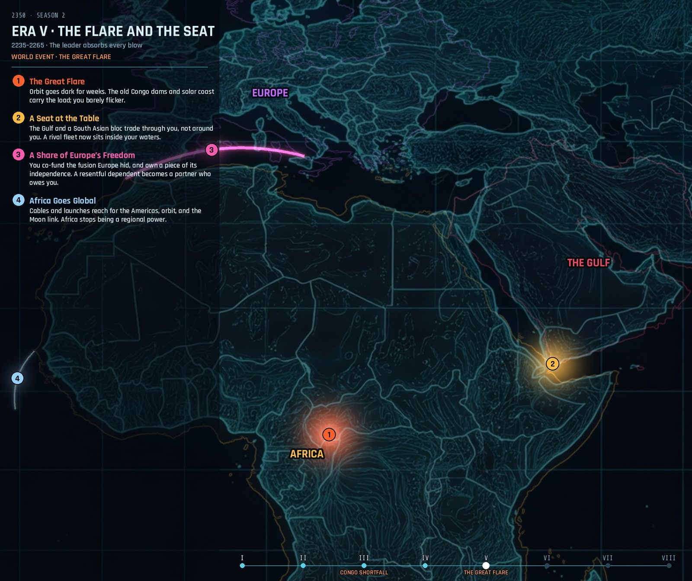
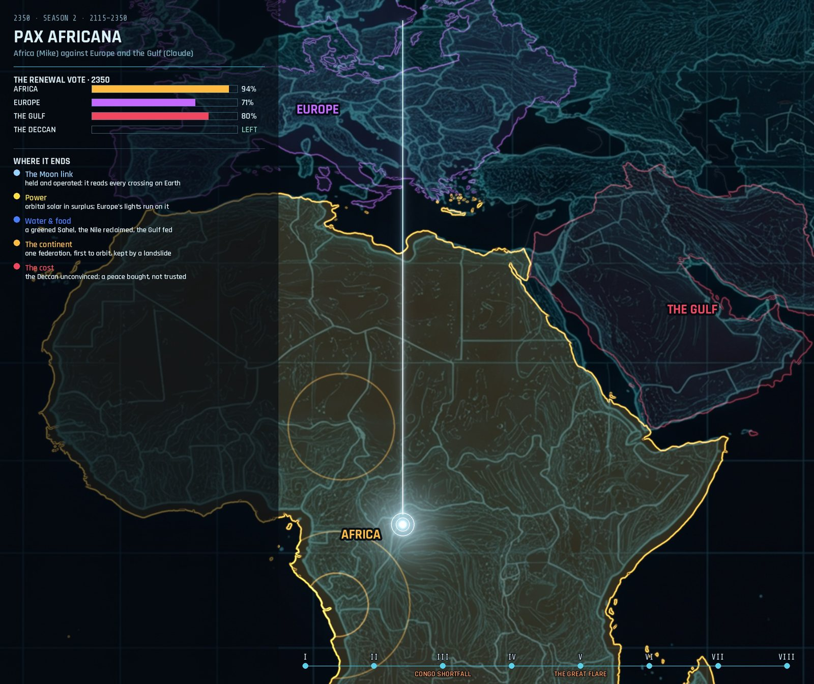

## Season 3: The Kept Word

**Australia in four areas, plus an unclaimed red centre · 8 eras · I played the Tropic North.**
- **The spine:** one water contract ran the whole season. It was sold south, honoured through a failed monsoon even when it meant rationing at home, out-competed by desalination, renewed at a higher price, and finally set free.
- **The pressure:** the AI areas went around the leader rather than through it, with a power line across the Nullarbor and a coalition from the west.
- **The ending:** the 2350 convention voted 4–0 for a two-house federation of three, and the West left as Westralia.

The closing vote gave the leader one vote of four. It was the first rule that made a runaway leader pay.

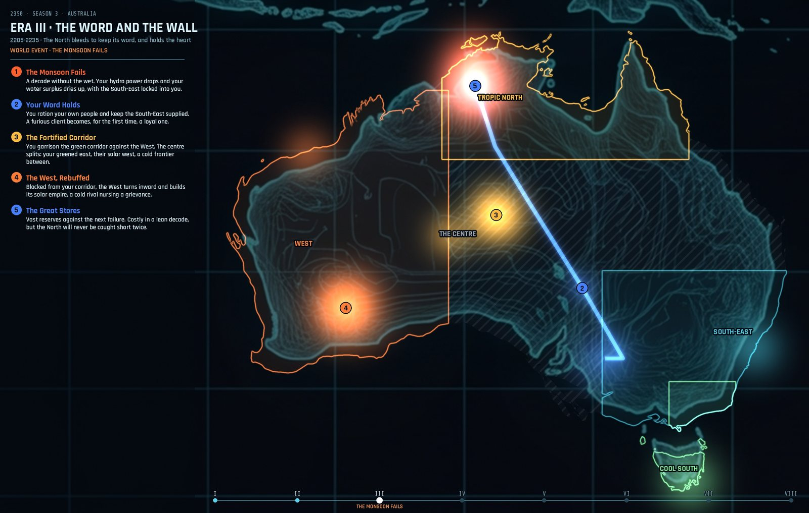
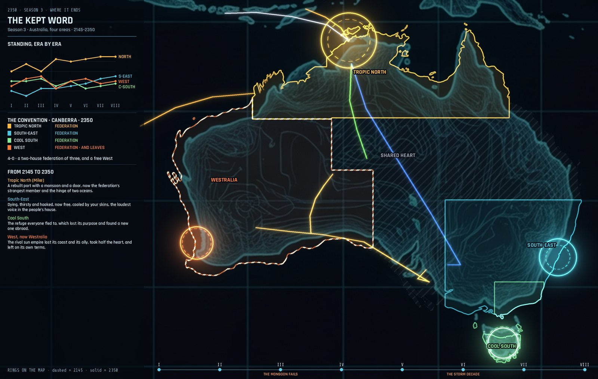

## Season 4: The Whole Truth

**South America in four areas, plus the unclaimed Amazon · 8 eras · I played the Andes.**
- **What I did:** I pushed this season dark on purpose to stress the game: two invasions, a strike with a weapon nobody had seen built, a suspended council and emergency rule.
- **The ending:** the Andes finished as the most powerful area of any season so far, and came third on the verdict. The weakest area won.

This was the first season judged by **the hidden verdict**: each area's own people score it in 2350, weighted by what they value and what they lived through. It also produced the rule against conjured capabilities, because that weapon should never have been possible.

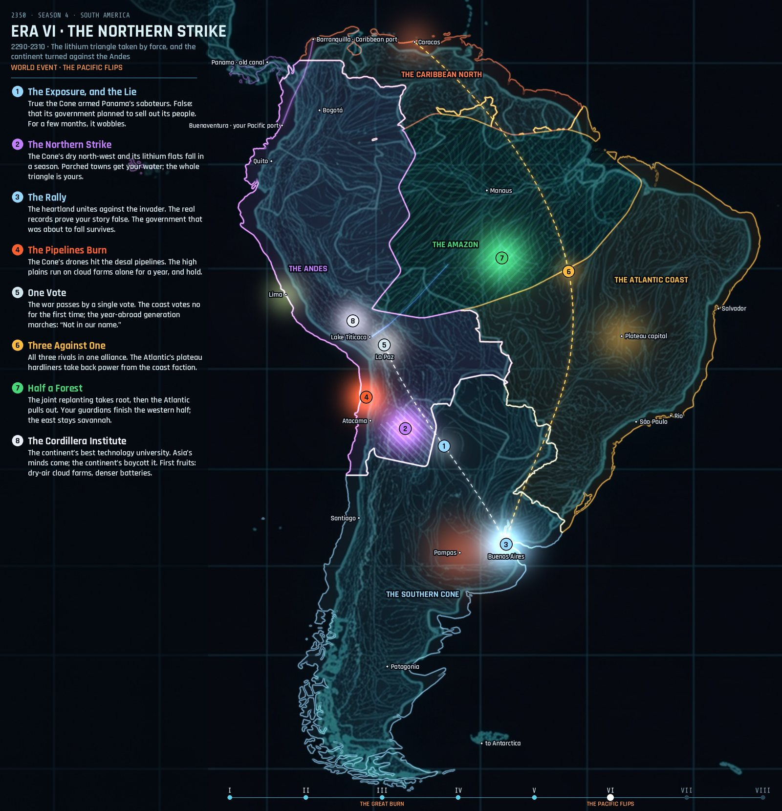
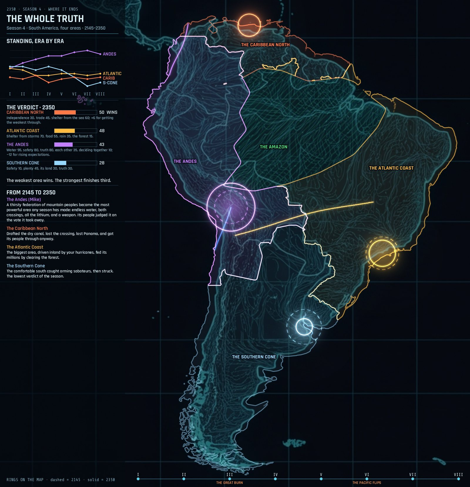

## Season 5: One Port

**Sydney at city scale: four powers instead of four districts · 6 eras · I played the Port.**
- **The powers:** the Council (law and rations), the Syndicate (organised crime selling what the Council rations), the Port (the dock unions and the hydrogen trade) and the Ridge (the mountain families).
- **The board:** districts are terrain, not players, and influence moves instead of borders. It's drawn from real elevation data, so the low ground floods for real.
- **The ending:** the Port won 61, ahead of the Ridge 42, the Council 30 and the Syndicate 26. Its price was the strike tradition it was founded on.

The score felt too harsh, because the people's safety was never scored, even though the Port protected them through every disaster. That led to **"the 100"**, and this season's card was its first test: re-scored that way, the Port came out at 74%.

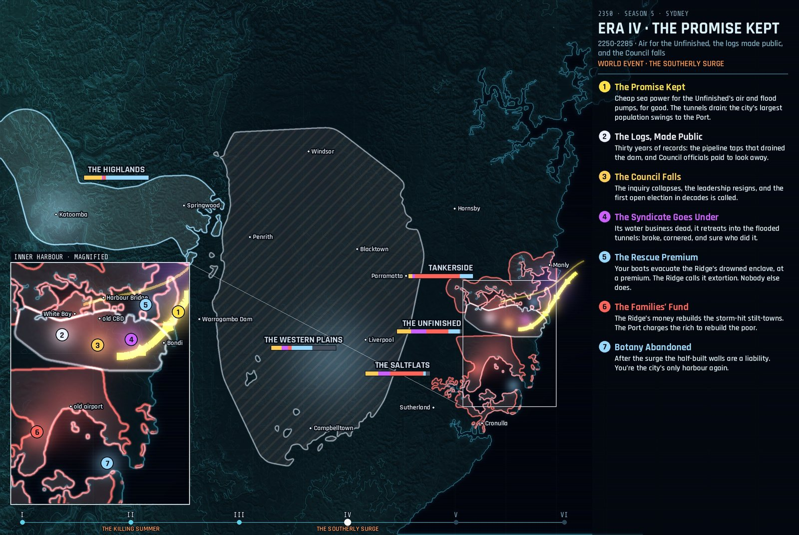
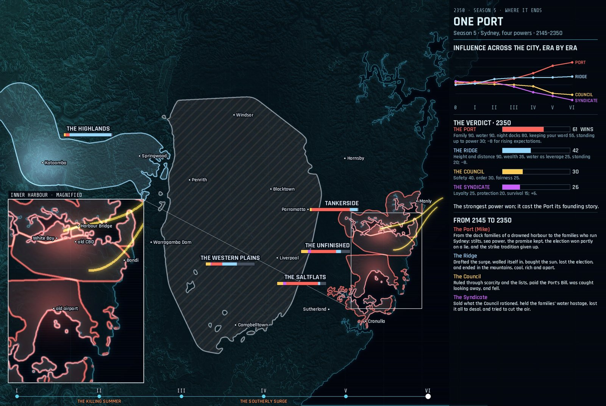
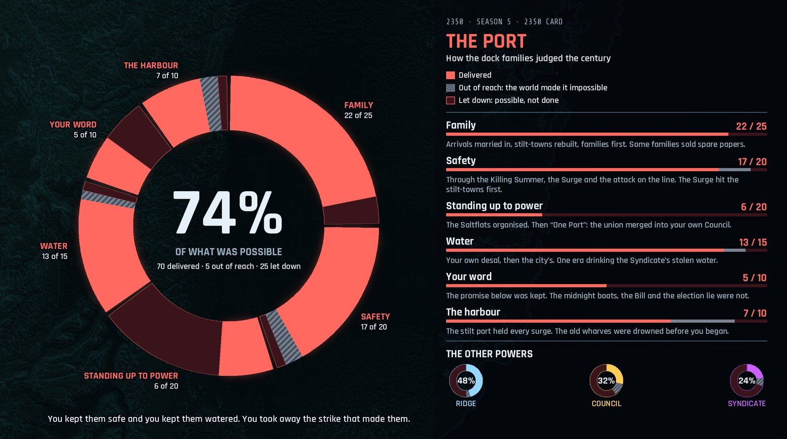

## Season 6: The Open Gate

**The world: six continental blocs, plus the unclaimed Thaw, Arctic, Antarctica and Moon Link · 10 eras · I played Asia.**
- **The century:** Asia moved sixty million people north into the Thaw. It joined Asia, Europe and Africa with the Landbridge, a cable across all three. It shared its gate keys and published its own monitoring.
- **The Thaw:** the frozen north it had settled grew into a seventh bloc, and Asia let it go.
- **The disasters:** three shock cards fired: the water towers failed, the Atlantic current collapsed, and the methane burst.
- **The ending:** Asia finished first at 80%, then Europe 67, Oceania 65, South America 62, Africa 58, the Thaw 54 and North America 50. Giving away half its land cost Asia nothing on the verdict, because its people valued the families on that land, not the land itself.

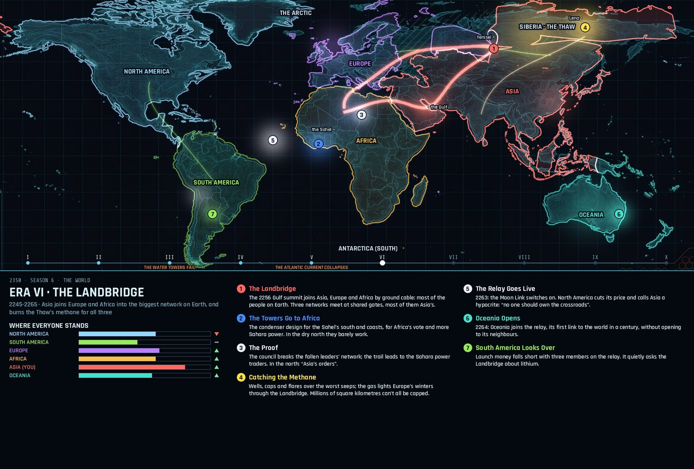
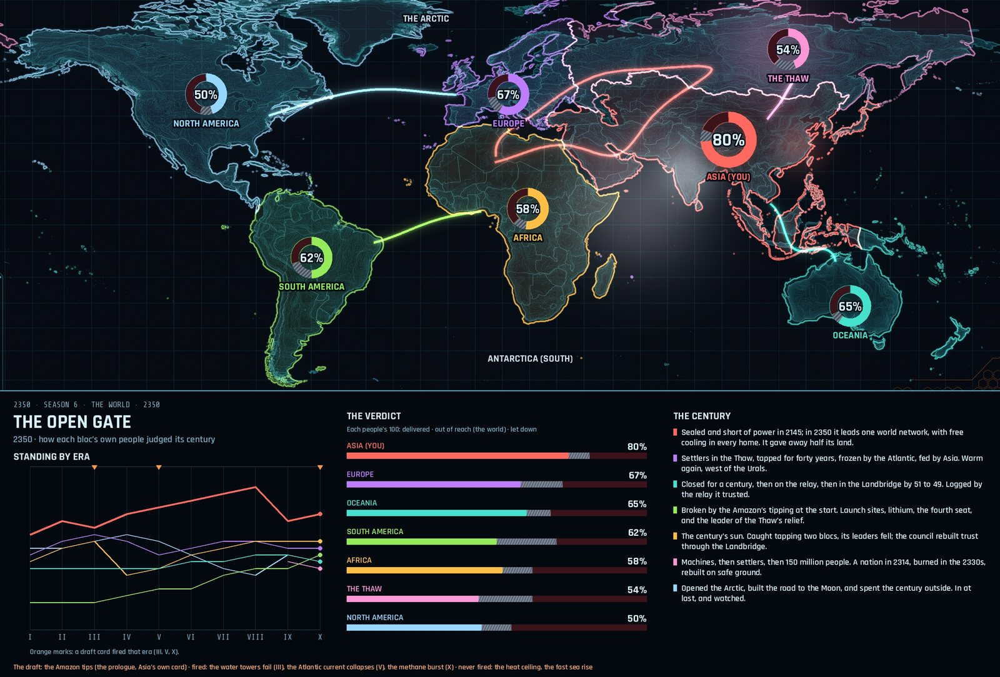
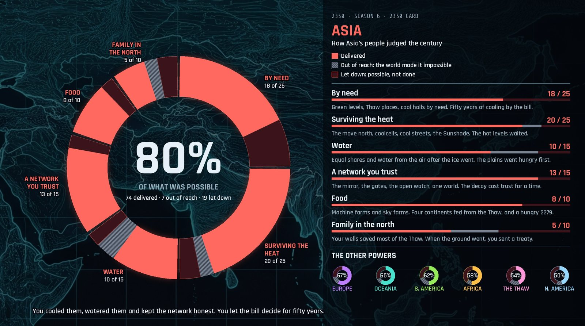
