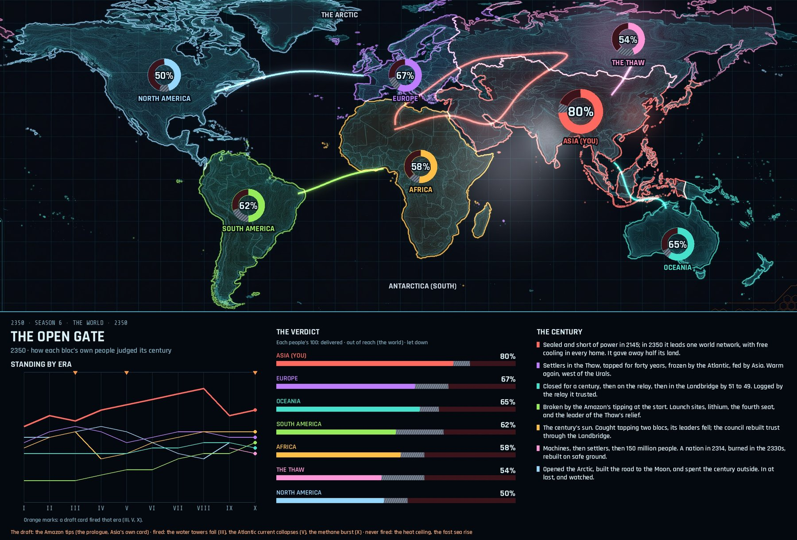

# The board engine

Every 2350 board is drawn in code: free to redraw and always on real geography. This folder draws the world boards for season 6 (global scale, six blocs, ten eras), its finale, and a 2350 card.



## Run it

```
pip install -r requirements.txt
python3 world_board.py base/base_global_v1.jpg out setup 1 2 3 4 5 6 7 8 9 10
python3 finale.py base/base_global_v1.jpg out/season6_finale.jpg
python3 card.py base/card_bg_asia.jpg out/season6_card_asia.jpg
```

## How it works

- **The base map** (`base/base_global_v1.jpg`) is a stylised world with no names, made with Google Gemini. It's calibrated to real longitude and latitude (`calib_world.json`), plus a thin-plate-spline correction (`warp_*_world.npy`) so places land on the coastlines as drawn.
- **Territory** comes from Natural Earth's country shapes (`data/`). Each bloc's area glows in its colour, and the glow's brightness is the bloc's strength that era.
- **Each era's events** are a list of numbered beats in `season6.py`: a glowing patch at a place, or a flow along a route, plus a title and one line for the key.
- **Changes carry over:** land that changes hands carries forward era to era, a fresh change is hatched in its old owner's colour, and earlier networks stay as dim lines.
- **The card** draws "the 100": a ring of everything a people wanted, each value split into delivered, out of reach and let down.

## Files

| File | What it is |
|---|---|
| `board.py` | The core library: projection, glow fields, text and lines. It was first written for season 1, whose Australian geography files aren't included here. |
| `world_board.py` | The world renderer: the setup board and one board per era. |
| `finale.py` | The 2350 board: every bloc's verdict ring, standing by era, and the arcs. |
| `card.py` | One power's 2350 card. |
| `season6.py` | Season 6's record: the setup, every era's beats and strengths, and the finale's verdicts. |
| `data/` | Natural Earth admin-0 countries at 1:50m (public domain). |
| `fonts/` | Rajdhani and Share Tech Mono, with their SIL Open Font License files. |
